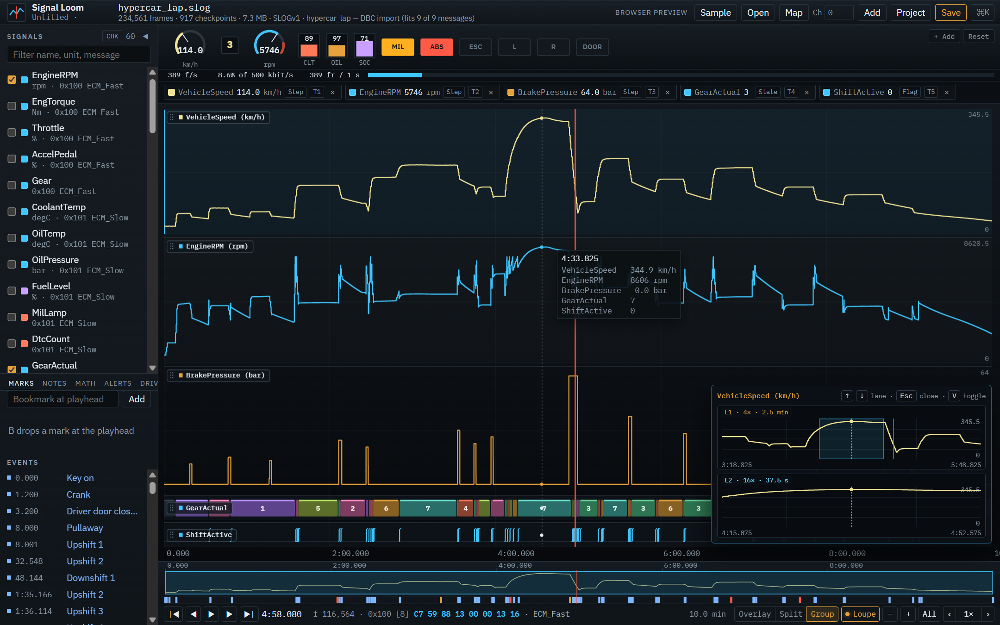
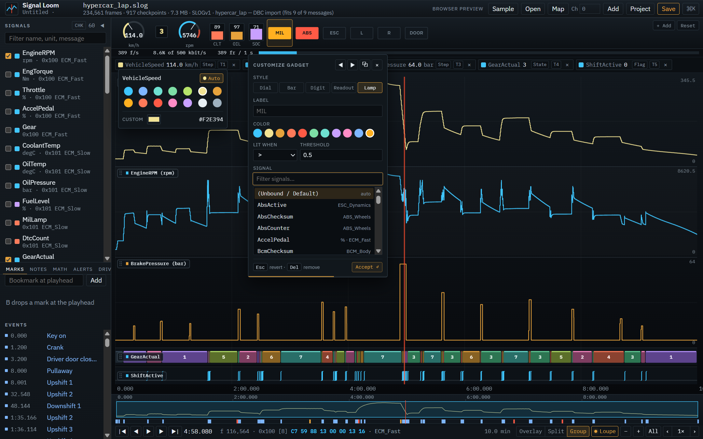
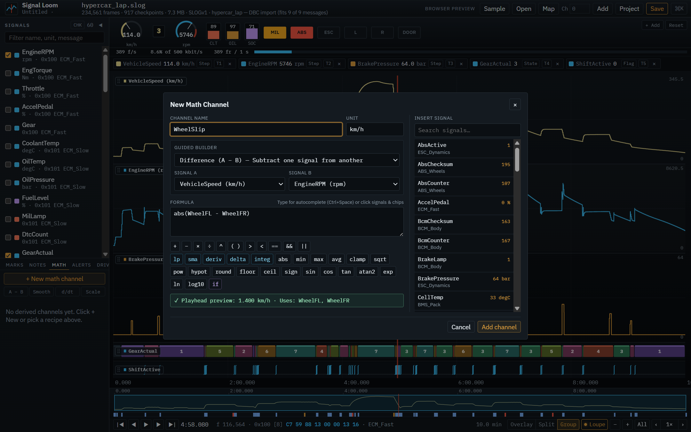
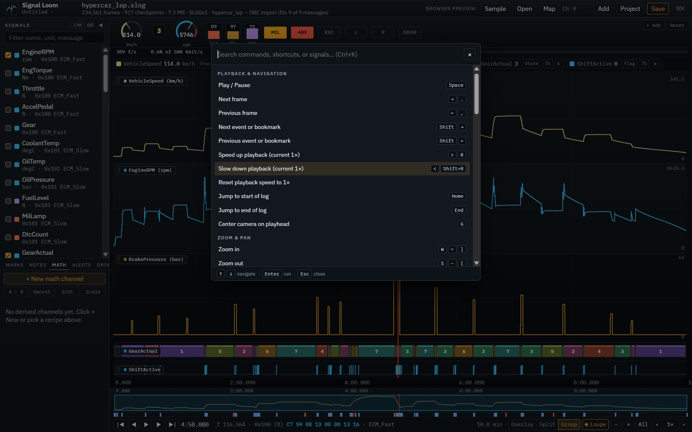
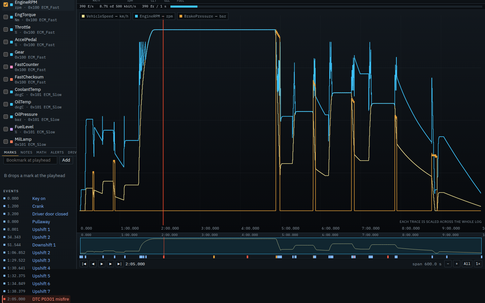
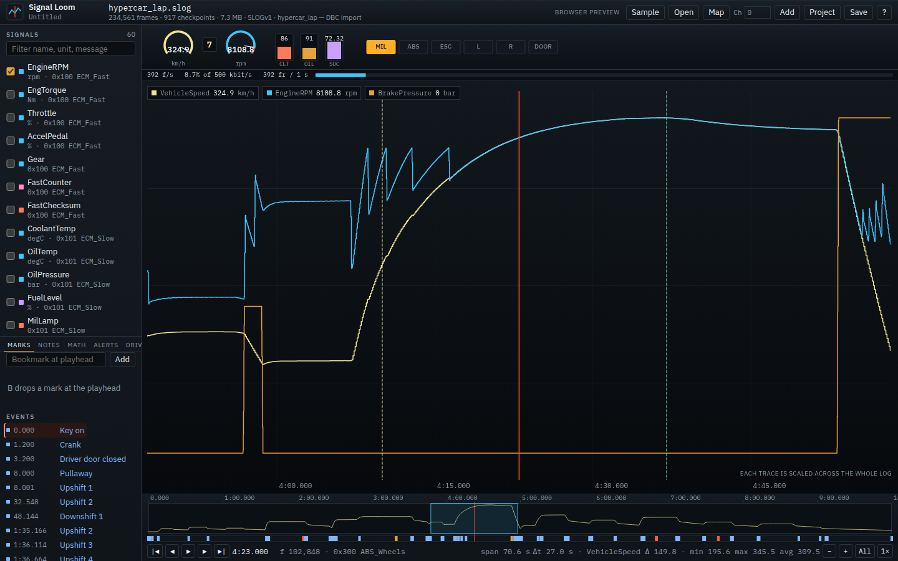
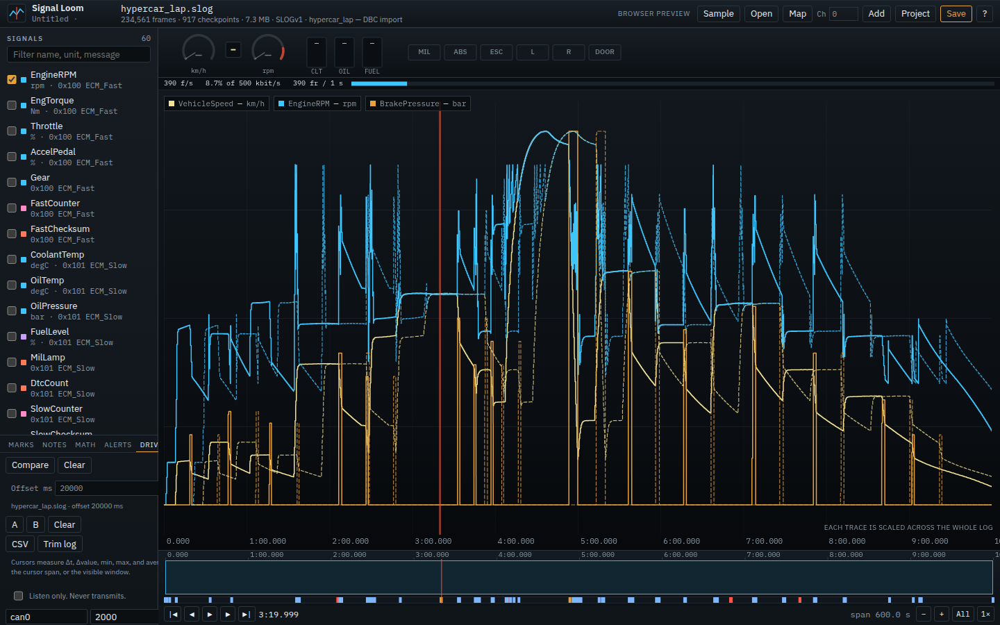
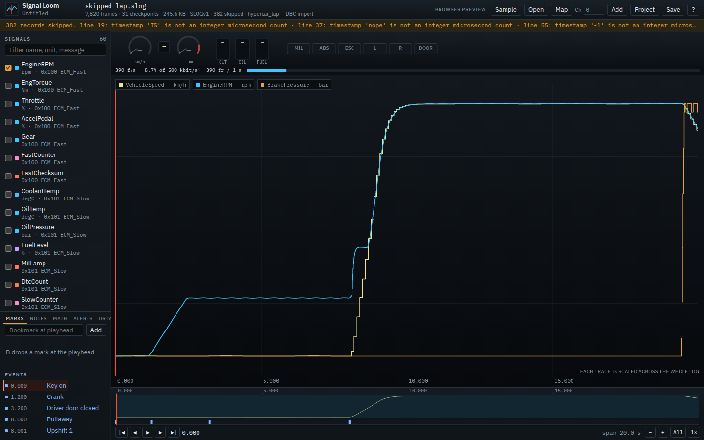

# Signal Loom

Signal Loom is a desktop log, CAN, and telemetry browser. Drop a recording on the deck, scrub the timeline, decode signals, build derived math channels, customize your instrument cluster, and inspect individual frames down to microseconds. It is built for instrument-cluster and vehicle work: a DAW for buses, not a slicer.

The heavy work stays in Rust. The window is a frameless Tauri 2 shell. The UI is TypeScript and Vite, and it only asks the indexer for the samples currently on screen.

## Screenshots

Desktop layout at 1440×900, using the synthetic 10-minute hypercar lap (`fixtures/hypercar_lap.slog` with `fixtures/hypercar_lap.dbc`). That recording is generated, not a capture from a vehicle.


The instrument deck mid-drive in **Group** mode: customizable gauges and telltales follow the playhead, analog signals stack cleanly above compact **State** (`GearActual`) and **Flag** (`ShiftActive`) ribbons, and the transport shows the zero-jitter colored raw CAN payload alongside the 3-position `Overlay | Split | Group` selector, `Loupe` toggle, and `0.1×–16×` playback speed controls.



The **2-level Hover Lane Magnifier** (`L1 · 4×` with a cyan bracket + `L2 · 16×` deep micro-view, working even past normal 1 ms max zoom). Pause briefly over any lane to inspect without cluttering fast sweeps, tap `↑`/`↓` to switch lanes while keeping your timeline timestamp locked, press `Esc` to dismiss, or toggle with `V` / **Loupe**.



Click any cluster gadget (or press `+`, or drag a signal directly from the Signals list onto the cluster strip) to customize style (`Dial`, `Bar`, `Digit`, `Readout`, `Lamp`), scaling, `WARN` glow thresholds, lamp conditions, and custom colors (`Enter` accepts; `Esc`, outside click, or 15 s of inactivity cancels). Click any color square in the legend or signal list to pick from 14 presets, choose any custom hex color, or reset to `Auto`.



**Math Channel Studio** (`Shift+M`): pick from 16 guided automotive recipes or write custom formulas (`lp`, `sma`, `deriv`, `delta`, `integ`, `abs`, `clamp`, `if`, trig, comparisons) with inline autocomplete (`Ctrl+Space`), searchable signals showing live values, and real-time playhead preview.



Fuzzy **Command & Shortcut Palette** (`Ctrl+K` or `?`): search commands, keyboard shortcuts, and live signals from one prompt.

<details>
<summary>More screenshots (events &amp; DTCs, measurement cursors, drive compare, malformed-record handling)</summary>









</details>

## Run it

Requirements: Node.js 22+, Rust 1.96.0 (pinned in `rust-toolchain.toml`), and the [Tauri Linux prerequisites](https://tauri.app/start/prerequisites/) (`webkit2gtk`, `gtk`, `librsvg`, `patchelf`) when you are on Linux.

```bash
npm install
npm run tauri dev
```

That builds the Rust core, starts Vite on [http://127.0.0.1:43127](http://127.0.0.1:43127), and opens the frameless Signal Loom desktop window. The first launch compiles Tauri, so it takes a while. Later launches are ordinary.

> **Custom ports (e.g., Windows Hyper-V/WinNAT port reservations)**: Override the default ports (`43127` UI / `43128` engine) with `LOOM_UI_PORT` and `LOOM_ENGINE_PORT`. In PowerShell:
> ```powershell
> $env:LOOM_UI_PORT=5173; $env:LOOM_ENGINE_PORT=5174; npm run dev:preview
> ```
> Or for Tauri desktop dev:
> ```powershell
> $env:LOOM_UI_PORT=5173; npx tauri dev --config '{\"build\":{\"devUrl\":\"http://127.0.0.1:5173\"}}'
> ```

### Browser preview

The same UI can run against a localhost copy of the indexer. This is for layout checks and browser-based inspection. The shipping app is the Tauri shell. Nothing listens on a public interface.

```bash
npm run dev:preview
```

Vite serves on `127.0.0.1:43127` (or `LOOM_UI_PORT`) and proxies `/api` to `loom-serve` on `127.0.0.1:43128` (or `LOOM_ENGINE_PORT`). The page shows a **Browser preview** badge. File open uses the browser file picker; the bytes are indexed by the local Rust process. To pre-open a local multi-gigabyte recording or `.loom` project directly from disk without browser upload limits, pass `--log` (with optional repeatable `--dbc FILE[@CHANNEL]`) or `--project` to `loom-serve`:

```bash
cargo run -p loom-serve --release -- --log drive.blf --dbc powertrain.dbc@1 --dbc chassis.dbc@2
```

When the browser preview connects (or reloads), it attaches to the startup scan or open session (`GET /api/summary`) instead of replacing it with the sample, and `POST /api/judge` evaluates `loom-judge/1` requests against the already-indexed recording in memory.

An uploaded project has no folder, so a relative log, map, or compare path in it is not resolved against the engine's working directory. The log is refused. A map or compare log is reported and left unopened.

### CLI inspection & specification judging (`loom-judge`)

`loom-judge` evaluates `loom-judge/1` specifications, dry-checks requests without reading a log, dumps `.dbc` / `.map.json` definitions, and inspects or slices recordings in a single streaming pass:

```bash
loom-judge --inspect --log drive.blf --dbc vehicle.dbc --no-hash
loom-judge --stats VehicleSpeed,BrakePressure --log drive.blf --dbc vehicle.dbc
loom-judge --samples VehicleSpeed --log drive.blf --dbc vehicle.dbc --from-us 0 --to-us 10000000 --max-points 200
loom-judge --check --dbc vehicle.dbc --request spec.json
loom-judge --log drive.blf --dbc vehicle.dbc --request - --out - < spec.json
```

## What's on the deck

Sample opens `fixtures/hypercar_lap.slog` with `fixtures/hypercar_lap.dbc` when those files are on disk. That is a synthetic 10-minute hybrid drive (urban, several corners, a chicane, a short top-speed straight, a second shorter straight, and a pit), not a capture from a vehicle. Speed is integrated from the torque curve, gear ratio, drag, rolling resistance, mass, a slow grade, and wind. Message ids are invented. The log plants a DTC, a counter skip, a missing ECM cycle, a bus-off burst, and one bad ABS checksum. `fixtures/cluster_drive.slog` is a shorter cluster trace, with `fixtures/cluster.map.json`. `fixtures/demo.loom` points at that shorter trace. `fixtures/decoded_snippet.csv` is a tiny pre-decoded trace.

`fixtures/hypercar_lap.dbc` is committed. `fixtures/hypercar_lap.slog` is not: the app reads it from disk when it is present and otherwise falls back to the short cluster sample, and the Rust test that checks the lap only needs the generated file. Regenerate it locally, and CI writes it before `cargo test`:

```bash
python3 scripts/gen_fixture.py
```

## What is real

- **Log formats & streaming indexer**: **SLOGv1 text**, **SLB1 binary**, **CAN CSV** (`t_us,id,data`), **decoded CSV** (`t_us,signal,value`), **Vector ASC** (absolute or relative time, CAN FD, extended ids, several channels), **Vector BLF** (classic CAN, CAN FD, error frames, zlib containers streamed one at a time), and **candump** lines are parsed and indexed. A large file is streamed with at most 4096 checkpoints and never loaded into one buffer. Opening a path shows percent, frame count, and a cancel button. Bad or truncated lines are skipped, counted, and listed; records up to 50 ms out of order are kept at the previous timestamp and counted.
- **DBC & JSON signal maps**: Little-endian (Intel) and big-endian (Motorola) bit layouts, signed values, factor, offset, multiplexed signals, and `VAL_` enum labels across up to 64-byte CAN FD payloads. Multiple DBCs can be stacked per channel (`0` applies everywhere). Duplicate signal names across messages are kept as `Name@<id>`. Drop a recording together with its `.dbc` in one gesture.
- **Semantic scope, lanes & custom colors**:
  - Dedicated 3-position **Overlay | Split | Group** selector (`L` to cycle) — auto-grouping by unit/message with shared Y-scale, or pinning custom tracks via `T1`/`T2` legend badges.
  - 7 per-signal visualization styles (`Auto`, `Step`, `Line`, `Area`, **State bar** enum ribbons, **Logic flag** pulse bands, and **Heat strips**). Compact ribbon lanes stack neatly below analog lanes.
  - Translucent frosted lane title pills sit on top of signals: drag vertically (or press `Alt+↑`/`Alt+↓`) to reorder lanes, or click a pill / legend chip to focus it while dimming (without hiding) the rest.
  - Click any signal's color square in the **Legend** or **Signals** list to pick from 14 curated hues, enter any custom hex color, or reset to `Auto`.
  - Checksums fold into their parent message's lane instead of taking a separate track; the Signals sidebar tags `CHK`/`CNT` housekeeping signals with a one-click `CHK` hide toggle.
- **Precision inspection & magnifiers**:
  - **2-level Hover Lane Magnifier** (`V` or **Loupe** button): pauses lazily (450 ms dwell), prefetches full-resolution samples before frame 1 (zero settle), and renders `L1 · 4×` and `L2 · 16×` views even past normal 1 ms max zoom (down to 10 µs). Tap `↑`/`↓` while hovering to rapidly A/B switch lanes at the exact same timestamp; press `Esc` to dismiss.
  - **Automatic Timeline Micro-Map Loupe**: hovering the timeline when zoomed in tightly pops up a magnified micro-map for accurate viewport panning, scrubbing, and wheel zooming.
  - Cursor-avoiding crosshair readout, zero-jitter fixed-prefix frame readout with signal-colored hex payload, `0.1×–16×` playback speed controls, and floating zero-reflow toast notifications.
- **Customizable instrument cluster**: Five widget types (**Dial**, **Bar**, **Digit**, **Readout**, **Lamp**) plus a one-second bus-load strip. Drag gadgets to reorder, drag signals from the Signals rail directly onto the cluster strip to add or rebind, or press **`+`** to add a gadget. Customize labels, scaling, `WARN` red glow highlights, lamp comparison operators, and preset or custom colors (`Enter` accepts; `Esc`, clicking outside, or 15 s of inactivity auto-cancels; `Del` removes).
- **Math Channel Studio (`Shift+M`)**: 16 guided recipes, editable channels, inline autocomplete (`Ctrl+Space`), searchable signal picker with live values, real-time preview, and a full Rust + TypeScript expression engine (`lp`, `sma`, `deriv`, `delta`, `integ`, `abs`, `min`, `max`, `avg`, `clamp`, `sqrt`, `pow`, `hypot`, trig, logs, comparisons, logical `&&`/`||`, `if`).
- **Landscape-first frameless UI & Command Palette**: Frameless desktop titlebar with Minimize / Maximize-Restore / Close controls, collapsible hover-peek Signals sidebar (`Ctrl+B`), toggleable cluster strip (`Shift+G`), and fuzzy-search **Command & Shortcut Palette** (`Ctrl+K` or `?`).
- **Complete `.loom` project persistence**: Atomically saves log/map/compare paths, bookmarks, notes, playhead, span, plotted signals, math channels, triggers, timeout factor, cursors, **cluster gadgets & order**, **signal colors & trace styles**, **track mode, manual groups, lane order**, and **panel visibility toggles**. Invalid math channels or triggers are dropped with a warning on open; saves are validated before writing.
- **Integrity watches, comparison & export**: Detects late messages (configurable timeout factor), broken counters, and bad checksums (XOR, byte sum, CRC-8/SAE-J1850, CRC-8H2F) on the severity-colored event lane. Supports second-drive comparison with time offset, A/B measurement cursors with window statistics, CSV and trimmed SLOGv1 export (up to 500,000 rows), and opt-in read-only SocketCAN capture on Linux.

## What is not in this build

- No cloud account. The app stays offline. Logs are read from local disk; nothing is uploaded.
- A `.loom` project does not follow a network path (`\\server\share\…`) for its log, map, or compare log: on Windows, merely checking such a path signs in to that server. Open a network file with Open instead.
- A math channel cannot use another math channel. The app refuses it and asks you to write the expression in full.
- SocketCAN never sends a frame. There is no transmit path.
- The browser preview upload is capped at 32 MB. Multi-gigabyte logs are opened by path (desktop app or `loom-serve --log`).
- The checksum watch picks signals by name: only an 8-bit, byte-aligned signal whose name contains `Checksum` is checked, and only one containing `Counter` is treated as a counter.
- BLF objects other than classic CAN, CAN FD, error frames, and zlib containers are skipped.
- The 10-minute lap is read from disk. A packaged build without the fixture falls back to the short cluster sample.

No decode path is mocked. The browser preview uses the same `loom-core` crate over localhost.

## Keyboard shortcuts

Press **`Ctrl+K`** (or **`?`**) anytime to search all commands and shortcuts interactively.

| Action | Keys |
| --- | --- |
| Command & shortcut palette | `Ctrl/Cmd+K`, `Ctrl/Cmd+Shift+P`, `?` |
| Open log / project | `Ctrl/Cmd+O`, `Ctrl/Cmd+Shift+O` |
| Save / Save as | `Ctrl/Cmd+S`, `Ctrl/Cmd+Shift+S` |
| Load built-in sample | `Ctrl/Cmd+Shift+L` |
| Play / pause | `Space` |
| Frame step | `←` / `→`, `,` / `.` |
| Event or bookmark step | `Shift+←` / `Shift+→` |
| Playback speed (0.1× – 16×) | `<` / `>`, `Shift+R` / `R` |
| Jump to start / end | `Home` / `End` |
| Center camera on playhead | `G` |
| Zoom in / out | `W` / `S`, `=` / `-`, `]` / `[`, or wheel toward cursor |
| Pan camera left / right | `A` / `D`, `Alt+drag`, or `Shift+wheel` |
| Zoom to fit all / box zoom / cursors | `F` or `0` (or double-click), `Shift+drag`, `Z` |
| Cycle track layout (Overlay / Split / Group) | `L` |
| Toggle 2-level hover lane magnifier | `V` |
| Switch magnified lane at locked time | `↑` / `↓` (while hovering) |
| Reorder focused lane up / down | `Alt+↑` / `Alt+↓` |
| Clear focus / dismiss magnifier | `Esc` |
| Add cluster gadget | `+` (then `Enter` accept, `Esc` cancel, `Del` remove) |
| New math channel (Studio) | `Shift+M` |
| Hide / pin Signals sidebar | `Ctrl/Cmd+B` |
| Hide / show cluster bar | `Shift+G` |
| Filter signals | `/` or `Ctrl/Cmd+F` |
| Bookmark / Note at playhead | `M` or `B` / `N` |
| Measurement cursors A / B / Clear | `1` / `2` / `3` |
| Maximize / restore desktop window | `F11` (or double-click topbar) |

## Log formats

SLOGv1, times in microseconds:

```text
SLOGv1
F 0 1A0 800C881378640000
E 2000000 Pullaway
```

`F` is a frame: timestamp, hex CAN id, hex payload (1–64 bytes). `E` is an event label. `X` is an error frame. `#` comments are ignored. A malformed line is skipped.

SLB1 is a little-endian binary: 16-byte header (`SLB1`, version 1), then records tagged `1` (frame: `u64` time, `u32` id, `u8` dlc, 8 data bytes) or `2` (event: `u64` time, `u16` length, utf-8 label).

CAN CSV ids are decimal unless they contain `A–F` or a `0x` prefix. Timestamps are always integer microseconds. A record that steps backwards in time is skipped and counted, so one glitch does not throw away the rest of the file.

Vector ASC is the text export (`base hex` or `base dec`, absolute or relative timestamps, `CANFD`, an id ending in `x` for 29-bit). BLF reads `LOGG` / `LOBJ` containers, including zlib, one container at a time (an inflated container is capped at 32 MB and then discarded). CAN FD frames keep up to 64 data bytes, with their channel and extended-id flag. candump lines look like `(seconds) can0 1A0#1122`, `(seconds) 1A0#1122`, or `can0 1A0 [8] 11 22 …`. Epoch candump clocks are rebased to the first frame. A line with no timestamp takes the time of the record before it.

A signal map looks like `fixtures/cluster.map.json`: messages, a CAN id, an optional `channel`, and signals with `startBit`, `bitLength`, `factor`, `offset`, `endian` (`little` or `big`), and optional multiplex fields. A Vector `.dbc` (`BO_` / `SG_` / `VAL_` / `GenMsgCycleTime`) imports to the same decoder. `SG_ … M` is the multiplexor; `m0`, `m1`, … are the cases. A log named `drive.slog` picks up `drive.dbc` beside it, or `drive.map.json` if there is no DBC. Add attaches another DBC on the channel in the toolbar.

## Project file

`.loom` is JSON (schema `version: 1`, backward-compatible across older saves):

```json
{
  "format": "signal-loom",
  "version": 1,
  "logPath": "fixtures/cluster_drive.slog",
  "signalMapPath": "fixtures/cluster.map.json",
  "bookmarks": [{ "id": "pullaway", "tUs": 2000000, "label": "Pullaway" }],
  "view": { "playheadUs": 2000000, "spanUs": 45000000, "plotted": ["VehicleSpeed", "EngineRPM"] },
  "laneMode": "grouped",
  "signalColors": { "VehicleSpeed": "#f2e394" },
  "signalStyles": { "GearActual": "state" },
  "signalLanes": { "VehicleSpeed": 1, "EngineRPM": 2 },
  "laneOrder": ["manual:1", "manual:2"],
  "clusterWidgets": [
    { "id": "speed", "kind": "arc", "signal": "VehicleSpeed", "color": "#f2e394" }
  ]
}
```

Paths resolve relative to the project file, then by walking parent directories. The built-in sample still opens if a project names `cluster_drive.slog` and the file is not on disk.

## Layout

```text
crates/loom-core     parse, index, decode, window query, judge evaluator
crates/loom-judge    CLI judge and DBC parity dump
crates/loom-serve    localhost preview of loom-core
src-tauri            Tauri 2 shell, unsigned builds
src                  Vite + TypeScript UI
fixtures             sample log, map, project, CSV snippet, judge contract
docs/screenshots     README screenshots
docs/release-notes   per-release notes attached by GitHub Actions
```

## Checks

`npm test` runs the frontend tests.

```bash
python3 scripts/gen_fixture.py
npm run typecheck
npm test
npm run build
cargo test -p loom-core -p loom-serve -p loom-judge
cargo clippy -p loom-core -p loom-serve -p loom-judge --all-targets -- -D warnings
cargo check -p signal-loom
```

`.github/workflows/ci.yml` keeps three job names stable: `frontend`, `rust`, and `tauri-smoke`.

## Installers

`.github/workflows/release.yml` builds unsigned installers on `workflow_dispatch` and on `v*` tags. Windows is an NSIS setup (`Signal Loom_1.0.0_x64-setup.exe` at the current version). Linux builds a `.deb` and an AppImage. macOS builds two dmgs, Apple silicon and Intel, after installing that job's Rust target on the Rust 1.96.0 toolchain pinned in `rust-toolchain.toml`. The installer name and wizard use the product name **Signal Loom**, with `src-tauri/icons/icon.ico` (Windows) and `icon.icns` (macOS).

This repository (`cristy-the-one/signal-loom`) is the main copy of Signal Loom. GitHub Actions runs CI and attaches the unsigned installers, including the Windows `x64-setup.exe`, to a draft GitHub Release. The Origin repository `marius-cristian/signal-loom` is the archived original and is no longer updated.
